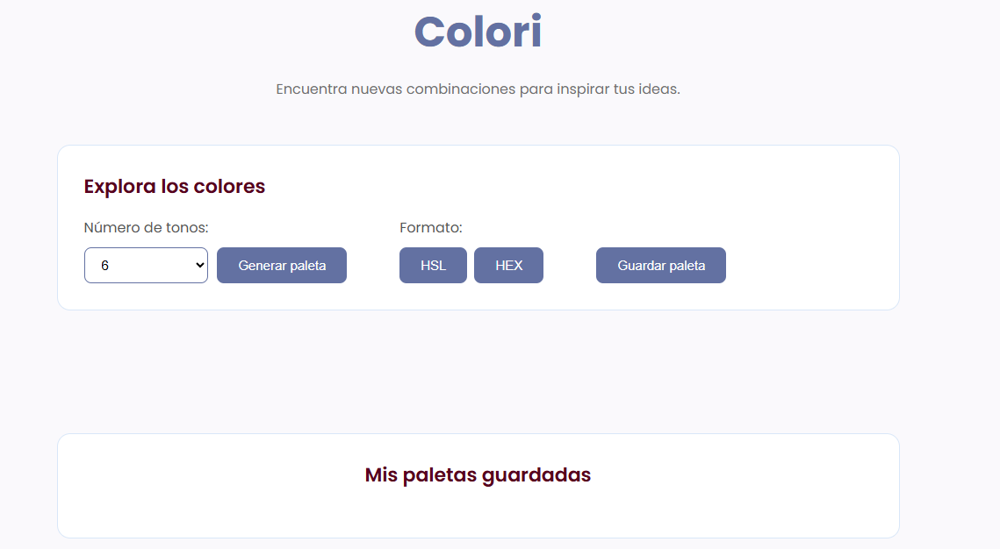
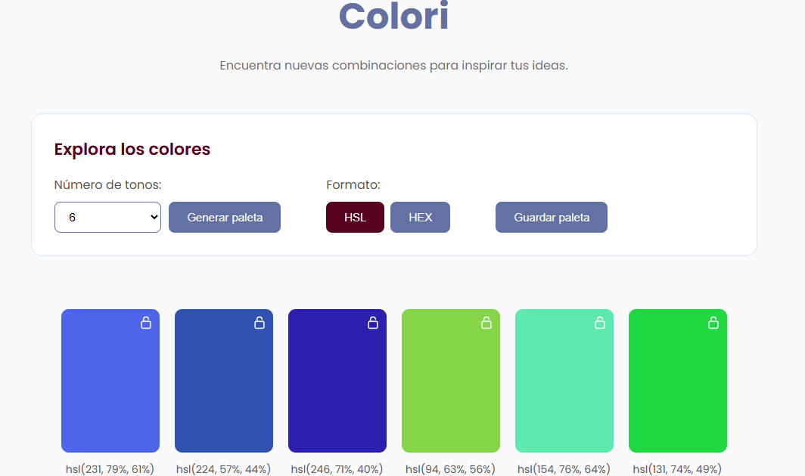
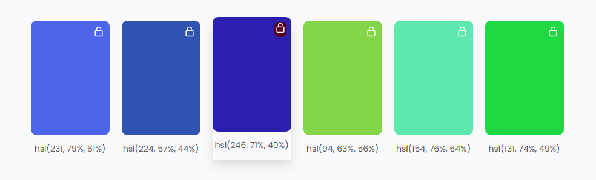
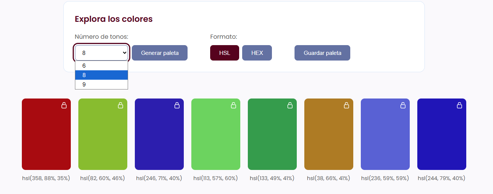
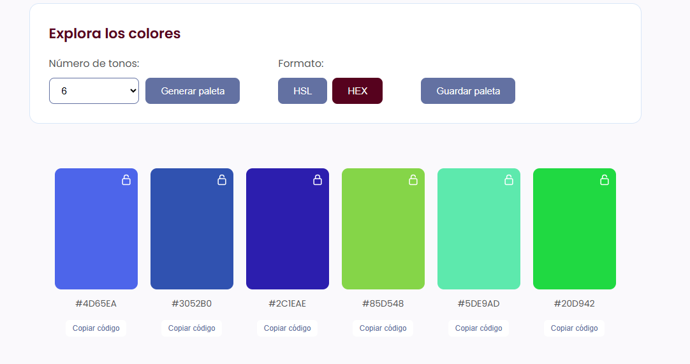
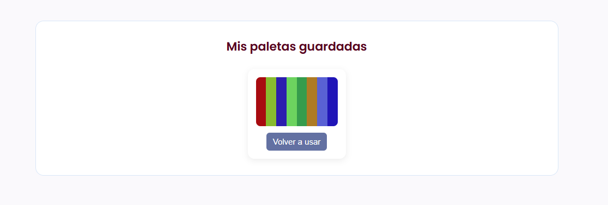
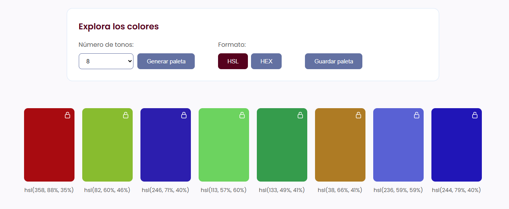

# Colori – Generador de paletas de colores

Colori es una aplicación web interactiva que permite generar paletas de colores aleatorias de manera sencilla. También permite elegir la cantidad de colores que queremos visualizar y cambiar entre los formatos HSL y HEX.

Además, se pueden bloquear los colores que más nos gusten para conservarlos al generar una nueva paleta, copiar sus códigos HEX y guardar las combinaciones favoritas para volver a utilizarlas más adelante.

## Aplicación publicada
Puedes probar Colori desde el siguiente enlace:

https://brianny-oria.github.io/Colori/

## Uso de la aplicación

1. Seleccionar la cantidad de colores que queremos generar: 6, 8 o 9.

2. Hacer clic en **Generar paleta** para obtener una combinación aleatoria.

3. Elegir entre los formatos HSL y HEX para visualizar los códigos de los colores.

4. Utilizar el botón de bloqueo para conservar los colores que nos gusten al generar una nueva paleta.

5. Hacer clic en **Copiar** para copiar el código HEX de un color.

6. Presionar **Guardar paleta** para almacenar una combinación y poder volver a utilizarla desde el historial.

### Cómo abrir el proyecto desde una computadora

Si quieres probar Colori desde tu computadora, puedes descargar el proyecto desde GitHub y abrirlo localmente siguiendo estos pasos:

1. Descargar o clonar el repositorio de Colori desde GitHub.

2. Abrir la carpeta del proyecto en Visual Studio Code.

3. Si no cuentas con Live Server, instala esta extensión de VS Code.

4. Ingresar a la carpeta Desarrollo.

5. Hacer clic derecho sobre index.html y seleccionar Open with Live Server.

### Pasos para realizar el despliegue

Para publicar Colori en GitHub Pages, se utiliza GitHub Actions mediante un archivo de configuración ubicado en `.github/workflows/deploy.yml`.

Los pasos para realizar el despliegue son:

1. Subir los archivos del proyecto a un repositorio de GitHub.

2. Ingresar al repositorio y abrir la sección **Settings**.

3. Seleccionar la opción **Pages** en el menú lateral.

4. En el apartado **Build and deployment**, seleccionar **GitHub Actions** como fuente de publicación.

5. Subir los cambios a la rama `master`. El archivo `deploy.yml` ejecutará automáticamente el proceso de publicación.

6. Ingresar a la sección **Actions** para comprobar que el proceso haya finalizado correctamente.

7. Una vez completado el despliegue, se podrá acceder a la aplicación mediante el enlace de GitHub Pages.

## Decisiones técnicas

Al desarrollar Colori se tomaron decisiones para poder organizar el proyecto y facilitar su funcionamiento:

- HTML: se utilizó para organizar el contenido de la página mediante una estructura semántica.

- CSS: se encargó del diseño visual, los colores, la distribución de los elementos y las animaciones.

- JavaScript: se utilizó para generar las paletas aleatorias y permitir la interacción con los distintos botones.

- Formato HSL: se eligió para generar los colores de manera aleatoria, ya que permite trabajar con el tono, la saturación y la luminosidad por separado.

- Conversión a HEX: se incorporó para mostrar los colores en un formato muy utilizado en diseño web.

- Manipulación del DOM: permitió crear y actualizar las tarjetas de colores directamente desde JavaScript, sin tener que escribirlas una por una en HTML.

- LocalStorage: se utilizó para guardar las paletas favoritas en el navegador y conservarlas aunque se cierre o actualice la página.

- Git y GitHub: se utilizaron para llevar un registro de los cambios realizados durante el desarrollo y mantener el código del proyecto en un repositorio.

## Posibles mejoras

Colori cuenta con las funciones principales propuestas para el proyecto. Sin embargo, en futuras versiones se podrían agregar algunas mejoras, como:

- Adaptar el diseño para que se visualice mejor en celulares y tablets.

- Seguir mejorando la estética y la presentación visual de la página.

- Incorporar opciones para generar paletas según diferentes estilos o tonalidades, como colores pasteles, fríos, cálidos o vibrantes.

- Agregar un botón para eliminar las paletas guardadas del historial.

- Agregar más formatos de color, como RGB.

## Uso de inteligencia artificial

Durante el desarrollo del proyecto utilicé ChatGPT como herramienta de apoyo para resolver dudas, comprender conceptos de JavaScript y desarrollar distintas funcionalidades de la aplicación.

Me ayudó a analizar y comprender fragmentos de código, así como a trabajar en funcionalidades como la generación de colores, el bloqueo de tonos, la copia de códigos HEX y el almacenamiento de paletas.

[Ver documentación del uso de IA](./documentacion-IA.md)

## Flujo de la aplicación

A continuación, se muestran capturas de las principales funcionalidades de Colori:

### 1. Página de inicio

### 2. Generación de una paleta

### 3. Bloqueo de un color

### 4. Selector de cantidad de colores

### 5. Cambio de formato HSL a HEX

### 6. Guardar una paleta

### 7. Recuperar una paleta

